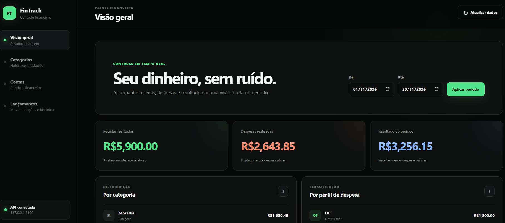
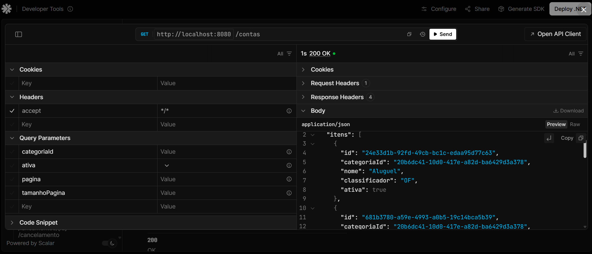

# FinTrack



Harness v1.8 — MVP financeiro em .NET 10, ASP.NET Core Minimal API, EF Core
SQLite, FluentValidation e Result Pattern.

O sistema gerencia Categorias, Contas (rubricas), Lançamentos, cancelamentos,
consultas, consolidações e o catálogo inicial de categorias. `Conta` não é conta
bancária; regras de negócio e arquitetura estão em `sdd/`.

## Executar com Docker

Pré-requisito: Docker Desktop com o Engine em execução.

```bash
docker compose up --build -d
```

O Compose cria o volume nomeado `fintrack-dados`, executa migrations e, em
seguida, inicializa uma vez as onze Categorias e os dados fictícios de Contas e
Lançamentos antes de iniciar a API. A carga é registrada no banco persistente;
reinícios não duplicam nem recriam exemplos editados ou removidos. A API fica
disponível em:

```text
http://localhost:8080/health
```

Verificar serviços e logs:

```bash
docker compose ps
docker compose logs api
docker compose logs migracoes
docker compose logs inicializacao
```

Parar sem apagar o banco:

```bash
docker compose down
```

Parar e apagar também os dados locais:

```bash
docker compose down -v
```

No Compose local, a API usa `Development`, então Scalar e OpenAPI ficam
disponíveis em `/scalar` e `/openapi/v1.json`. Isso é exclusivo da execução
local; deploys Production não devem publicar essas rotas. A carga de
demonstração é exclusiva do serviço local `inicializacao`; a API nunca executa
migrations ou seed no próprio startup.

Para iniciar a API, a carga inicial e o Scalar pelo Docker, execute na raiz do
repositório:

```powershell
docker compose up --build -d
```

Abra o Scalar em [http://localhost:8080/scalar](http://localhost:8080/scalar)
ou o documento OpenAPI em
[http://localhost:8080/openapi/v1.json](http://localhost:8080/openapi/v1.json).

## Executar o frontend Angular

Pré-requisitos: Node.js 22.19 ou compatível e npm 10.9. Mantenha os serviços
Docker acima em execução para a API e o proxy do Angular.

Em outro terminal PowerShell, na raiz do repositório:

```powershell
Set-Location src/FinTrack.Web
npm ci
npm start
```

Abra [http://localhost:4200](http://localhost:4200). O servidor Angular usa
`proxy.conf.json` para encaminhar as chamadas da SPA à API em
`http://127.0.0.1:8080`.

## Executar localmente

Pré-requisito: .NET SDK 10 e acesso ao NuGet.

```bash
dotnet tool restore
dotnet restore FinTrack.slnx
dotnet build FinTrack.slnx --no-restore
dotnet ef database update --project src/FinTrack.Infrastructure --startup-project src/FinTrack.Infrastructure
dotnet test FinTrack.slnx --no-build
```

No PowerShell, iniciar explicitamente em desenvolvimento na porta 5100:

```powershell
$env:ASPNETCORE_ENVIRONMENT = 'Development'
dotnet run --project src/FinTrack.Infrastructure --urls http://127.0.0.1:5100
```

Nesse modo, os recursos de documentação ficam disponíveis em:

- http://127.0.0.1:5100/scalar
- http://127.0.0.1:5100/openapi/v1.json

Para carregar explicitamente as onze categorias iniciais após aplicar as
migrations:

```bash
dotnet run --project src/FinTrack.Infrastructure -- --inicializar-categorias
```

## Rotas e verificação

Rotas principais: `/categorias`, `/contas`, `/lancamentos`, `/consolidados` e
`/health`.

Exemplo de verificação da API em Docker:

```bash
curl -i http://localhost:8080/health
```

As falhas esperadas seguem `ProblemDetails`: validação de entrada retorna 400,
recurso inexistente 404 e conflitos de negócio, como duplicidade, retornam 409.

## Arquitetura e persistência

- Arquitetura hexagonal: `FinTrack.Core` contém Domain e Application;
  `FinTrack.Infrastructure` concentra HTTP, DI, EF Core e SQLite.
- A direção de dependência é `Infrastructure → Core`; o Core não referencia
  HTTP, EF Core, Docker ou Scalar.
- O banco SQLite evolui exclusivamente por EF Core Migrations. Não há
  `EnsureCreated` nem aplicação automática de migrations no startup da API.
- Docker executa migrations separadamente, antes de iniciar a API. Consulte
  [ADR-004](sdd/adr/ADR-004-migracoes-ef-core.md) e
  [ADR-011](sdd/adr/ADR-011-containerizacao-api.md).
- Scalar é uma referência OpenAPI interativa exclusiva de Development. Consulte
  [ADR-010](sdd/adr/ADR-010-documentacao-api-scalar.md).

## Testes e validações

```bash
dotnet restore FinTrack.slnx
dotnet build FinTrack.slnx --no-restore
dotnet test FinTrack.slnx --no-build
dotnet ef migrations has-pending-model-changes --project src/FinTrack.Infrastructure --startup-project src/FinTrack.Infrastructure
docker compose config --quiet
```

Os testes de integração usam `WebApplicationFactory` e SQLite isolado. O
registro de commits e validações está em
[sdd/progresso/REGISTRO-COMMITS.md](sdd/progresso/REGISTRO-COMMITS.md).

## SDD

- [PLAYBOOK.md](PLAYBOOK.md) — sequência e regras de execução.
- [Requisitos](sdd/requisitos/REQUISITOS.md) — regras de produto e negócio.
- [Domínio](sdd/dominio/DOMINIO.md) — modelo e invariantes.
- [SPECs](sdd/specs/) — especificações das features F01 a F12.
- [ADRs](sdd/adr/) — decisões arquiteturais aceitas.

Para evoluir uma feature, siga `AGENTS.md` e use `$feature-orchestrator`.

