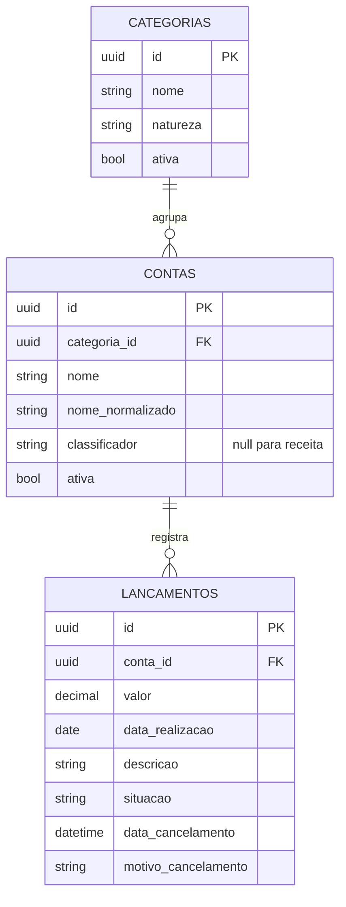

# FinTrack — Modelo de Domínio

**Versão:** 0.1 · **Status:** proposta revisável. O modelo conceitual está estabilizado; propriedades adicionais aguardam ratificação conforme REQUISITOS.md.

## Relações

`uuid` aqui indica alinhamento provisório à PoC (.NET `Guid`); o diagrama inicial sugeria `int`. A escolha de persistência definitiva está pendente em DP-07. `data_cancelamento` e `motivo_cancelamento` são **propostas**, não campos aprovados.

## Entidade Categoria — tabela `categorias`

| C# (`Categoria`) | SQL | Tipo lógico | Observação |
|---|---|---|---|
| Id | id | Identificador | PK. Tipo a confirmar. |
| Nome | nome | Texto | Obrigatório, normalização de nome a especificar. |
| Natureza | natureza | Receita/Despesa | Restrições de alteração pelo histórico. |
| Ativa | ativa | Booleano | Inativação lógica. |

Métodos de domínio propostos: `Criar`, `Renomear`, `Inativar`, `Reativar` (últimos sujeitos a regras históricas).

## Entidade Conta — tabela `contas`

| C# (`Conta`) | SQL | Tipo lógico | Observação |
|---|---|---|---|
| Id | id | Identificador | PK. |
| CategoriaId | categoria_id | Identificador | FK para Categoria. |
| Nome | nome | Texto | Obrigatório, até 100 caracteres. |
| NomeNormalizado | nome_normalizado | Texto | Apoio à unicidade. |
| Classificador | classificador | OF/OV/NOF/NOV ou null | Obrigatório em despesas e nulo em receitas. |
| Ativa | ativa | Booleano | Desativação sem exclusão histórica. |

Métodos de domínio propostos: `Criar`, `Renomear`, `DefinirClassificador`, `Inativar`, `Reativar` (seguindo DP-04/DP-05). Fonte da regra de nome: Value Object `NomeConta`. **Conta é rubrica, não conta bancária.**

## Entidade Lancamento — tabela `lancamentos`

| C# (`Lancamento`) | SQL | Tipo lógico | Observação |
|---|---|---|---|
| Id | id | Identificador | PK. |
| ContaId | conta_id | Identificador | FK para Conta. |
| Valor | valor | Decimal | Positivo; precisão a decidir. |
| DataRealizacao | data_realizacao | Data | Fato realizado; regra de tempo a ratificar. |
| Descricao | descricao | Texto opcional | Limite a decidir. |
| Situacao | situacao | Realizado/Cancelado | Sem reversão de cancelamento. |
| DataCancelamento | data_cancelamento | Data/hora opcional | Proposta de auditoria. |
| MotivoCancelamento | motivo_cancelamento | Texto opcional | Proposta de auditoria. |

Métodos propostos: `Registrar`, `Cancelar`. Não armazenar `Natureza` nem `Classificador` diretamente na entidade Lançamento.

## Restrições relacionais

- `categorias.id` → `contas.categoria_id` (N:1); `contas.id` → `lancamentos.conta_id` (N:1).
- Bloquear exclusão física/cascata destrutiva quando houver vínculo histórico.
- Unicidade da Conta por `nome_normalizado` é regra vigente da PoC, com possível evolução após DP-01.
- Alterar natureza/categoria/classificador com histórico exige política definida antes da feature.
- Integridade de FKs e unicidade devem existir também no banco.

## Exemplos — 10 linhas por tabela (dados ilustrativos)

**Categorias:** 1 Moradia DESPESA; 2 Alimentação DESPESA; 3 Transporte DESPESA; 4 Saúde DESPESA; 5 Educação DESPESA; 6 Lazer DESPESA; 7 Assinaturas DESPESA; 8 Impostos DESPESA; 9 Salário RECEITA; 10 Rendimentos RECEITA. **Freelance** é a 11ª categoria da seed.

**Contas:** (1,1,Aluguel,OF); (2,2,Supermercado,OV); (3,3,Combustível,OV); (4,4,Plano de saúde,OF); (5,5,Curso de inglês,NOF); (6,6,Cinema,NOV); (7,7,Netflix,NOF); (8,8,IPTU,OF); (9,9,Salário principal,null); (10,10,Juros de investimentos,null).

**Lançamentos:** (1,9,8500.00,2026-10-05); (2,1,1800.00,2026-10-06); (3,2,650.00,2026-10-07); (4,3,250.00,2026-10-08); (5,4,750.00,2026-10-09); (6,5,320.00,2026-10-10); (7,6,85.00,2026-10-12); (8,7,44.90,2026-10-15); (9,8,180.00,2026-10-18); (10,10,125.50,2026-10-20). Todos realizados nos exemplos.

## Orientação de código e idioma

- Classes/entidades/métodos/propriedades de negócio: **português, sem acentos nos identificadores**; exemplos: `Lancamento`, `DataRealizacao`, `Cancelar`, `CalcularResultado`.
- SQL: tabelas e colunas em `snake_case` pt-BR, por exemplo `lancamentos.data_realizacao`.
- JSON HTTP: campos públicos em pt-BR (`nome`, `categoriaId`, `classificador`, `valor`, `dataRealizacao`).
- Namespaces/projetos `FinTrack.Core` / `FinTrack.Infrastructure` e nomes técnicos conhecidos das Skills podem ser mantidos; novos tipos de negócio devem ser nomeados em pt-BR.
- O legado PoC v1.8 ainda possui apenas Conta (sem `CategoriaId`), esquema `Contas` e endpoints da PoC. **Renomeação e migração são trabalho futuro**, não alteração deste pacote documental.
